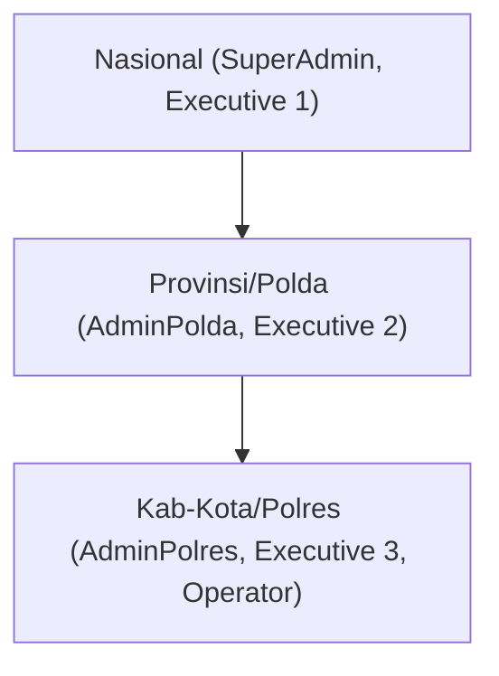

# 📊 DOKUMENTASI SISTEM AKSES: ROLE, PERMISSION, DAN CAKUPAN WILAYAH (TERRITORY)
## Smart Back Office (SBO) Laravel

Dokumen ini menjelaskan secara mendetail arsitektur keamanan, hak akses (permissions), tingkatan role (role tiers), dan penyaringan data geografis (territory scoping) yang diterapkan pada sistem Smart Back Office (SBO) Laravel.

---

## 🏗️ 1. RINGKASAN ARSITEKTUR AKSES

Sistem SBO menggunakan perpaduan **3 Dimensi Kontrol Akses** untuk menentukan apakah seorang pengguna dapat melihat, menambah, mengubah, atau menghapus data:

1. **Role Tiers (Tingkatan Fungsi)**: Terdiri dari 7 level matriks role utama (SuperAdmin hingga Executive) yang mendefinisikan batas kemampuan fungsional.
2. **Territory Levels (Cakupan Geografis)**: Membatasi visibilitas data berdasarkan wilayah tugas yang tercantum pada profil pengguna (`nasional`, `provinsi`/Polda, atau `kab_kota`/Polres).
3. **Mutation Modes (Kebijakan Perubahan Data)**: Mengontrol hak penulisan data (CRUD) berdasarkan peran operasional pengguna (`full`, `territory`, `own`, atau `view` saja).



---

## 👤 2. SKEMA IDENTITAS PENGGUNA (USM)

Identitas pengguna dikelola dalam model `App\Models\Usm` yang memetakan ke tabel database `usm`. Terdapat beberapa kolom krusial yang menentukan alur hak akses:

*   **`user_role_id`**: Kunci asing (FK) yang memetakan pengguna ke tabel `roles`. Digunakan untuk mendeteksi ID matriks role pengguna.
*   **`daerah`**: Menyimpan nama Polda/Provinsi (misalnya: `METRO JAYA`, `JAWA BARAT`).
*   **`wilayah`**: Menyimpan nama Polres/Kabupaten-Kota (misalnya: `JAKARTA PUSAT`, `BANDUNG`).
*   **`account_status`**: Menentukan keaktifan akun (misalnya: `active`, `pending`).

### Trait `HasHierarchicalFilter`
Model `Usm` menyertakan trait `App\Traits\HasHierarchicalFilter` untuk memudahkan controller/query memanggil filter hierarki dan melakukan pengecekan level pengguna secara langsung melalui method:
*   `scopeApplyHierarchicalFilter($query, $level)`
*   `getUserLevel()`
*   `canAccessLevel($requiredLevel)`

---

## 🎛️ 3. TINGKATAN MATRIKS ROLE (7 TIERS)

Sistem memetakan setiap `user_role_id` ke dalam 7 tingkatan matriks role utama yang didefinisikan dalam `config/role_menu_matrix.php`:

| ID Matriks | Nama Role | Cakupan Geografis | Mode Mutasi (CRUD) | Deskripsi Fungsional |
| :---: | :--- | :--- | :--- | :--- |
| **1** | **SuperAdmin / SA** | Nasional (Pusat) | `full` | Akses konfigurasi penuh, mengabaikan semua filter daerah & database permission. |
| **2** | **AdminPolda** | Provinsi (Polda) | `territory` | Mengelola (CRUD) seluruh data di tingkat polda/provinsi kerjanya. |
| **3** | **AdminPolres** | Kab/Kota (Polres) | `territory` | Mengelola (CRUD) seluruh data di tingkat polres/kab-kota kerjanya. |
| **4** | **Operator** | Kab/Kota (Polres) | `own` | Menginput data baru; hanya boleh mengubah/menghapus data milik sendiri. |
| **5** | **Executive3** | Kab/Kota (Polres) | `view` (Read-only) | Executive tingkat Polres; hanya melihat data lingkup kab-kota kerja tanpa izin CRUD. |
| **6** | **Executive2** | Provinsi (Polda) | `view` (Read-only) | Executive tingkat Polda; hanya melihat data lingkup polda kerja tanpa izin CRUD. |
| **7** | **Executive1** | Nasional (Pusat) | `view` (Read-only) | Executive tingkat Pusat; melihat data seluruh Indonesia tanpa izin CRUD. |
| **8** | **Ditlantas** | Provinsi (Polda) | `territory` | Mengelola (CRUD) data tingkat polda/provinsi kerjanya (sejajar Polda). |

---

## 🗺️ 4. LEVEL CAKUPAN GEOGRAFIS (TERRITORY LEVELS)

Didefinisikan dalam kelas `App\Support\TerritoryLevelForUsm`. Setiap pengguna diselesaikan (resolved) tingkat wilayahnya sebagai salah satu dari:

1.  **`nasional`** (Pusat): Diperuntukkan bagi SuperAdmin (1) dan Executive1 (7).
2.  **`provinsi`** (Polda): Diperuntukkan bagi AdminPolda (2), Executive2 (6), dan Ditlantas (8).
3.  **`kab_kota`** (Polres): Diperuntukkan bagi AdminPolres (3), Operator (4), dan Executive3 (5).

Jika role ID tidak tergolong ke dalam daftar di atas, sistem akan mendeteksinya secara dinamis:
*   Jika kolom `wilayah` terisi dan tidak diawali dengan kata `"wil "`, dikategorikan sebagai `kab_kota`.
*   Jika kolom `daerah` terisi, dikategorikan sebagai `provinsi`.
*   Jika keduanya kosong, dikategorikan sebagai `nasional`.

---

## 🔒 5. KEBIJAKAN MUTASI DATA (ROLE MUTATION POLICY)

Kebijakan penulisan data (Insert, Update, Delete) diatur terpusat dalam berkas `App\Support\RoleMutationPolicy` dan dijaga oleh middleware `EnforceRoleMutationPolicy`.

### 4 Mode Mutasi Utama (`role_mutation_modes`):
1.  **`full`**: Akses tak terbatas (untuk SuperAdmin).
2.  **`territory`**: Pengguna hanya dapat melakukan perubahan pada data yang berada di lingkup Polda (AdminPolda) atau Polres (AdminPolres) kerja mereka.
3.  **`own`**: Operator hanya dapat mengubah/menghapus baris yang dibuat oleh dirinya sendiri. Kepemilikan baris dicek dengan mencocokkan kolom `piket` atau `id_usm` data dengan ID akun login.
4.  **`view`**: Pengguna tipe Executive tidak diperbolehkan melakukan mutasi data apa pun. Request POST/PUT/PATCH/DELETE akan diblokir dengan respon `403 Forbidden`.

### Aturan Kepemilikan Data Operator (`own`):
Sistem melacak kepemilikan baris operasional melalui kolom `piket` atau `id_usm`.
*   Saat menyimpan data baru (`store()`), kolom `piket` otomatis diisi dengan ID akun login pengguna (`id_usm`).
*   Jika operator berada dalam mode `own`, sistem memanggil `RoleMutationPolicy::assertCanEditOrDelete()` untuk mencocokkan apakah data tersebut milik operator tersebut.
*   **Perbaikan Otomatis Orphan Data**: Pada tabel tertentu seperti `dataperangkat`, jika data tidak memiliki kolom pemilik (`piket` kosong atau `0`), sistem secara otomatis memperbaiki data yatim piatu tersebut dengan menetapkan operator yang sedang mengakses sebagai pemiliknya (`repairOrphanOperationalPiketForOperator`).

---

## 🔍 6. MEKANISME PENYARINGAN DATA (QUERY SCOPING)

Penyaringan data agar pengguna hanya melihat data sesuai dengan lingkup wilayah kerjanya dilakukan secara otomatis menggunakan class helper **`App\Helpers\HierarchicalHelper`** dan **`App\Support\TerritoryIndexFilters`**.

### Standard Scoping di Controller
Dalam penulisan query di controller tingkat operasional (CRUD), query disaring menggunakan:
```php
// Batasi data sesuai cakupan wilayah user (menggunakan whereExists subquery)
HierarchicalHelper::applyTerritoryScopeForTable($query, 'table_name', 'table_alias');

// Terapkan filter tambahan dari input request pencarian (daerah / wilayah)
\App\Support\TerritoryIndexFilters::applyUsmFilters($query, $request);
```

### Metode Penyaringan `applyTerritoryScopeForTable`:
Metode ini secara pintar memeriksa kolom yang tersedia pada tabel target:
*   Jika tabel memiliki kolom `daerah` dan `wilayah`, filter disaring langsung berdasarkan kolom tersebut.
*   Jika tabel memiliki kolom `piket` atau `id_usm`, sistem melakukan `whereExists` ke tabel `usm` untuk memverifikasi daerah dan wilayah dari pembuat data tersebut.
*   Jika tabel memiliki kolom `id_profileposko`, filter diarahkan melalui relasi tabel `profilposko`.
*   Jika tidak ada kolom yang cocok, query dipaksa menghasilkan baris kosong (`1 = 0`) untuk menjaga integritas data.

---

## 🚪 7. SISTEM VALIDASI AKSES ROUTE & MENU

Validasi apakah seorang user boleh mengakses URL tertentu dilakukan oleh middleware `CheckPermission` bersama dengan `MenuHelper`.

```mermaid
flowchart TD
    User([User Request]) --> Authenticated{Authenticated?}
    Authenticated -->|No| Redirect[Login Page]
    Authenticated -->|Yes| CheckRole[Get Matrix Role ID]
    
    CheckRole --> SA{Role = 1 (SA)?}
    SA -->|Yes| AllowAll[Bypass All Checks / Full Access]
    SA -->|No| CheckPermissions[Check role_permissions for page/action]
    
    CheckPermissions --> HasPerm{Has Permission?}
    HasPerm -->|No| Abort403[403 Forbidden]
    HasPerm -->|Yes| MutationCheck{Is it a mutating request?<br/>add/edit/delete}
    
    MutationCheck -->|No| ReadFilter[Apply Geographic Scoping Filter]
    ReadFilter --> ServeData([Return View / Data])
    
    MutationCheck -->|Yes| MutationMode{Role Mutation Mode}
    MutationMode -->|view| RejectMutation[403: Read-Only Executive]
    MutationMode -->|territory| TerritoryCheck{Is record within user's<br/>daerah/wilayah?}
    TerritoryCheck -->|No| RejectMutation
    TerritoryCheck -->|Yes| PerformMutation([Execute Mutation])
    
    MutationMode -->|own| OwnCheck{Does user own record?<br/>piket/id_usm matches user}
    OwnCheck -->|No| RejectMutation
    OwnCheck -->|Yes| PerformMutation
```

### Mekanisme `CheckPermission` Middleware:
1.  **Bypass SuperAdmin**: Jika pengguna adalah SuperAdmin, validasi dilewati.
2.  **Deteksi Permission Otomatis**: Jika permission tidak didefinisikan secara eksplisit di rute middleware, sistem mendeteksinya secara dinamis dari nama controller dan action method.
    *   *Contoh*: `TerminalController@index` diterjemahkan menjadi permission `data_terminal/list`.
    *   *Contoh*: `TerminalController@create` diterjemahkan menjadi permission `data_terminal/add`.
3.  **Pencarian Matriks Sidebar**: Memeriksa menu yang diizinkan untuk role ID tersebut di config `role_menu_matrix.menu_access`.
4.  **Pencarian Database**: Memeriksa tabel `role_permissions` dengan filter `role_id` (role user) dan kombinasi `page_name/action_name`. Jika tidak ditemukan, akses ditolak (`403 Unauthorized`).

---

## 👥 8. SCOPE KHUSUS: DAFTAR PENGGUNA (USER LISTING SCOPE)

Khusus modul manajemen personil (`Personil Manager` / `/admin/users`), sistem menerapkan penyaringan yang sangat ketat melalui class `App\Support\UserListingScope`:

*   **Penyembunyian Akun SuperAdmin**: Pengguna non-SuperAdmin dilarang keras melihat akun dengan role SuperAdmin.
*   **Batas Executive**: Akun bertipe Executive hanya diperbolehkan melihat personil dengan role **Operator** (`MenuHelper::personilBoOperatorUserRoleIds()`). Mereka tidak dapat melihat akun Admin atau Executive lainnya.
*   **Kewajiban Pengisian Profil Teritori**:
    *   Jika pengguna bertipe *Operator* atau *Executive Provinsi/Kab-Kota* belum mendefinisikan `daerah` / `wilayah` di profil mereka, daftar personil diblokir sepenuhnya (`1 = 0`) disertai pesan peringatan agar melengkapi profil organisasi terlebih dahulu.
*   **Penyaringan Hirarki Admin**:
    *   *Admin Polres (Kab/Kota)*: Hanya menampilkan pengguna yang memiliki `daerah` dan `wilayah` yang sama.
    *   *Admin Polda (Provinsi)*: Menampilkan seluruh pengguna dalam provinsi/daerah tersebut, ditambah pendaftaran akun baru (`pending`) yang daerahnya belum diset.

---

## 📁 9. BERKAS KONFIGURASI DAN SOURCE CODE UTAMA

Untuk melakukan perubahan aturan akses atau menambahkan modul baru, silakan merujuk pada berkas-berkas berikut di dalam codebase:

1.  **Konfigurasi Aturan Utama**:
    *   [`config/role_menu_matrix.php`](file:///c:/laragon/www/smartbackoffice-laravel/config/role_menu_matrix.php) (Definisi tingkatan role, mode mutasi data, dan hak akses rute menu).
    *   [`config/menu.php`](file:///c:/laragon/www/smartbackoffice-laravel/config/menu.php) (Daftar menu sidebar administrator beserta batasan teritori yang diperbolehkan).
2.  **Middleware Keamanan**:
    *   [`app/Http/Middleware/CheckPermission.php`](file:///c:/laragon/www/smartbackoffice-laravel/app/Http/Middleware/CheckPermission.php) (Gerbang pengecekan hak akses URL).
    *   [`app/Http/Middleware/EnforceRoleMutationPolicy.php`](file:///c:/laragon/www/smartbackoffice-laravel/app/Http/Middleware/EnforceRoleMutationPolicy.php) (Gerbang pencegah penulisan data ilegal).
3.  **Logika Pendukung & Filter Query**:
    *   [`app/Support/RoleMutationPolicy.php`](file:///c:/laragon/www/smartbackoffice-laravel/app/Support/RoleMutationPolicy.php) (Logika detail mode mutasi data).
    *   [`app/Helpers/HierarchicalHelper.php`](file:///c:/laragon/www/smartbackoffice-laravel/app/Helpers/HierarchicalHelper.php) (Logika query scoping database berdasarkan wilayah).
    *   [`app/Support/TerritoryIndexFilters.php`](file:///c:/laragon/www/smartbackoffice-laravel/app/Support/TerritoryIndexFilters.php) (Penyaringan opsi daerah/wilayah di UI).
    *   [`app/Support/UserListingScope.php`](file:///c:/laragon/www/smartbackoffice-laravel/app/Support/UserListingScope.php) (Penyaringan khusus untuk data pengguna / Personil Manager).
